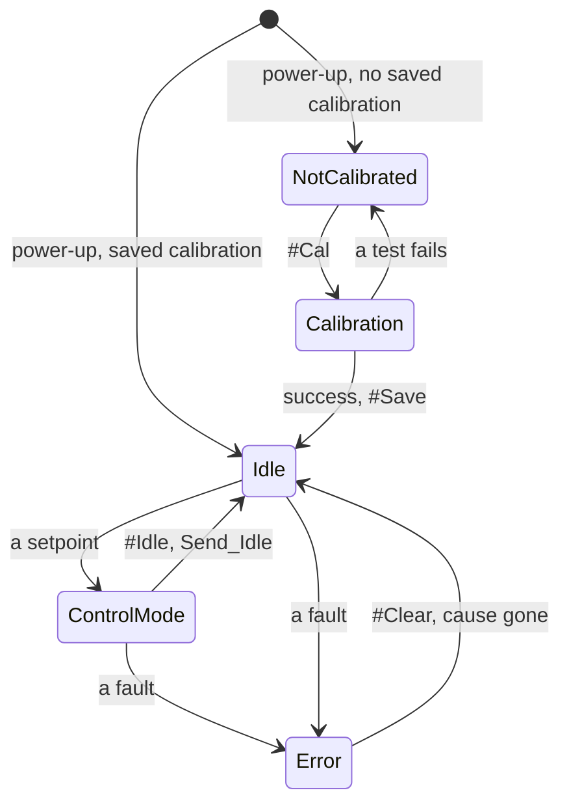

# Control modes

The driver is always in one control mode. A command that carries a setpoint switches to the mode that uses it;
`#Idle` or Send_Idle switches back to idle. The driver refuses the closed-loop modes while it is not calibrated or
while an error is active.

A setpoint is `#P`, `#V`, `#Iq`, `#PD` or a CAN motion frame, and a new setpoint switches the mode without
passing through idle; a fault is any of the errors on [Errors and recovery](https://docs.source-robotics.com/Spectral-BLDC-docs/107/06-operation/errors/).

| ControlMode | What the motor does | Entered by | Setpoint unit |
|---|---|---|---|
| Idle | nothing: coasts (phases open) or brakes (phases shorted), as set by `#Brake` or Send_Settings | `#Idle`, Send_Idle, `#Clear`, errors | — |
| Position | holds and moves to a position with the cascade of position, velocity and current loops | `#P`, Send_data_pack_1 (8 bytes) | encoder ticks |
| Velocity | turns at a speed with the velocity and current loops | `#V`, Send_data_pack_1 (5 bytes) | encoder ticks/s |
| Current (torque) | applies a current, so a torque, with the current loop alone | `#Iq`, Send_data_pack_1 (2 bytes) | mA |
| PD (impedance) | behaves like a spring and a damper around a position, with `KP` and `KD` | `#PD`, Send_data_pack_PD | encoder ticks |
| Voltage torque | applies a voltage on the q axis directly, without the current loop | `#Uq` | mV |
| Open loop | turns the stator field at a set electrical speed without the encoder in the loop; the rotor follows it like a stepper | `#Openloop` | electrical speed |
| Gripper | runs the gripper state machine: move to a jaw position with a speed and a current limit | `#Grippos`, Send_gripper_data_pack (with `#Gripper 1`) | 0 to 255 |
| Calibration | the calibration routine, or the gripper calibration | `#Cal`, `#Gripcal` | — |

## Units

- **Position** is in encoder ticks: 16384 per revolution of the motor shaft, counting up without limit over
  several revolutions. Positive is counter-clockwise seen from the encoder side of the board, see below.
- **Speed** is in encoder ticks per second: 16384 is one revolution per second, 60 rpm.
- **Current** is in mA. Torque is current times the motor's Kt, which calibration finds.
- **Feedforward**: the 8-byte motion frame carries a speed and a current feedforward beside the position, the
  5-byte one a current feedforward beside the speed. They are added after the loops, so a host that knows the
  trajectory can command it directly and leave the loops to correct the rest. Send 0 when you do not use them.

## Try it

  

    <label for="uc-ticks">Ticks (a position, or a speed per second)</label>
    <input id="uc-ticks" type="number" name="ticks" step="1" value="16384">
    <label for="uc-pp">Pole pairs</label>
    <select id="uc-pp" name="pp">
      <option value="7">7</option>
      <option value="11" selected>11 (the gimbal motors)</option>
      <option value="14">14</option>
      <option value="21">21</option>
    </select>
  

  
As a position: <strong data-out="turns">1.000</strong> turns, <strong data-out="deg">360.0°</strong> · as a speed: <strong data-out="rpm">60</strong> rpm · the practical maximum for 11 pole pairs is about <strong data-out="maxrpm">2727</strong> rpm

  

    <label for="uc-kt">Kt in Nm/A (what #Kt prints)</label>
    <input id="uc-kt" type="number" name="kt" step="0.01" min="0" value="0.30">
    <label for="uc-ma">Current in mA</label>
    <input id="uc-ma" type="number" name="ma" step="10" value="1000">
  

  
Torque: <strong data-out="nm">0.30 Nm</strong>, <strong data-out="ncm">30 N·cm</strong>

The units of this page, with your numbers: 16384 encoder ticks per turn, the practical speed limit from the
electrical frequency the control loop can follow ([Ratings and limits](https://docs.source-robotics.com/Spectral-BLDC-docs/107/03-technical-data/ratings/)), and
the torque as Kt times the current.

## Positive rotation

<figure markdown="span">
  { width="520" }
  <figcaption>Figure 15: Looking at the encoder side of the board, the side that faces the magnet, positive rotation is counter-clockwise. A positive current turns the motor that way, a positive speed too, and the position grows.</figcaption>
</figure>

The direction is tied to the encoder, not to the wiring: since firmware 105 calibration compensates the order of
the phases, so the motor turns the same way whichever wire went to which terminal.

## Which mode am I in?

`#Mode` prints the mode: `Idle mode`, `Position control`, `Speed control`, `Current control`, `PD control`,
`Open loop`, `Gripper mode` or `Gripper calib mode`. The voltage-torque mode has no label of its own in this
release; `#Info` and the behaviour of the motor are the check there.
