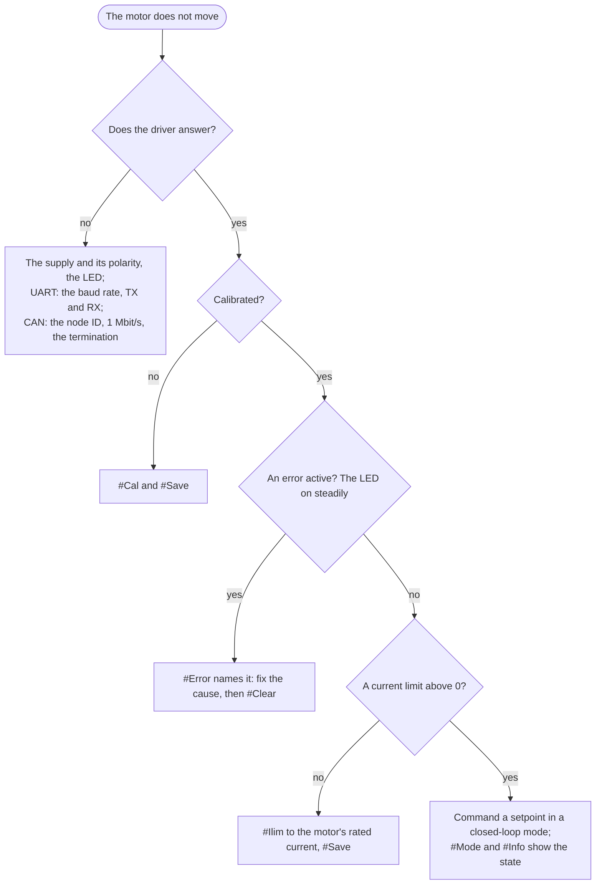

# Troubleshooting

By symptom. The error flags and what clears them are in [Errors and recovery](https://docs.source-robotics.com/Spectral-BLDC-docs/107/06-operation/errors/).

## The motor does not move

## The driver does not answer

| Symptom | Check |
|---|---|
| No LED | the supply, DC+ and DC−, the power cable's orientation. If the cable was the wrong way round the driver is destroyed |
| LED on, nothing on the terminal | 256000 baud; TX to RX and RX to TX; the adapter's port; 3.3 V adapter; the line ending CR+LF |
| LED on, nothing on CAN | the node ID; 1 Mbit/s on the adapter; termination (about 60 Ω across CAN H and CAN L with everything unpowered); the CAN cable's orientation |
| `Unknown command` | the name's spelling and case: `#Kpiq`, not `#kpiq` |
| the LED is off and nothing works after a firmware update | the bootloader has no valid firmware: flash again, see [Updating through the bootloader](https://docs.source-robotics.com/Spectral-BLDC-docs/107/07-firmware/update/) |

## Motor GUI

| Symptom | Check |
|---|---|
| the browser offers no port | a Chromium-based browser (Chrome, Edge, Brave, Opera); Firefox and Safari have no Web Serial |
| the port is listed but will not open | another program holds it: a terminal, PlatformIO's monitor, the Arduino serial monitor |
| the port opens, nothing appears | the driver's power; TX and RX crossed on a non-Source adapter; the baud rate on a non-Source adapter (256000) |
| *No connection* on CAN | the CANvas adapter's port; the bus termination; the node ID of the driver; 1 Mbit/s |
| the calibration does not start | calibration runs over the serial connection only, not over CAN |
| *Unsaved changes* after a power cycle | the settings were not saved to the driver; Save writes them |
| the firmware update finds no bootloader | a driver with firmware 104 or older has no bootloader: [Installing the bootloader on an older board](https://docs.source-robotics.com/Spectral-BLDC-docs/107/07-firmware/bootloader/) |

## Calibration

The messages and their causes are in [Calibration](https://docs.source-robotics.com/Spectral-BLDC-docs/107/05-setup/calibration/). The ones that
come back most:

| Symptom | Cause |
|---|---|
| `Magnet test: Failed` | magnet too far, axially magnetised, or missing |
| the motor wobbles left and right during calibration | one phase is not connected |
| `Open loop: Failed` | the motor did not turn: a phase open, the open-loop voltage (`#Openv`) too low for the motor |
| `Phase order is wrong!` | the motor did not respond to the commutation check; wiring, current limit, magnet |
| calibration succeeds, the motor then runs badly or in the wrong direction | the magnet slipped on the shaft; glue it and calibrate again |
| calibration succeeds but the LED stays on and `#Error` shows nothing | `#Info` shows `-1`: `#Default`, calibrate again |

## The motor

| Symptom | Cause |
|---|---|
| crunching or whining at speed | the current limit or the current loop gains too high; lower `#Ilim`, lower `#Cbw` and calibrate again, or lower `#Kpiq` |
| humming, oscillating at rest | `#Kpv` or `#Kpp` too high; see [Current limit and loop tuning](https://docs.source-robotics.com/Spectral-BLDC-docs/107/05-setup/tuning/) |
| weak torque | `#Ilim` low; the supply's current limit; a calibration run at a low supply voltage (the constants are off) |
| the motor is hot | lower `#Ilim`, enable the thermistor; a gimbal motor held against a load at its current limit heats quickly |
| it stops with a Vbus error when decelerating | the supply cannot absorb the returned energy; a different supply, or a brake resistor |
| it stops with a velocity error | the speed limit `#Vlimit`, or a load that lets the motor overrun |
| it falls behind under a load | the torque limit: raise `#Ilim` within the motor's rating, or a bigger motor |
| it holds position with a sawtooth noise | the position loop gain; the magnet distance |

## Low-quality motors

Motors with visibly bad windings, an uneven back-EMF or a resistance that differs between the phases calibrate
poorly and run rough. The [tested motors](https://docs.source-robotics.com/Spectral-BLDC-docs/107/03-technical-data/tested-motors/) are known good.

## The magnet and the encoder

- The distance is 1 mm. "Magnet Good" from the magnet test does not mean the distance is right, only that the
  field is strong enough.
- A magnet touching the chip can destroy the microcontroller; a magnet too far gives a noisy, wrong position.
- The magnet must be diametrically magnetised and centred on the shaft.

## The driver gets hot or shuts down

The MOSFET driver stage shuts down on its own overtemperature or overcurrent and reports a driver error. Lower
the current limit, give the board airflow, check the motor leads for a short. Near 2.8 A the driver needs
cooling.

## After a firmware update

`#Info` shows the new release. If the values look wrong or the LED stays on: `#Default`, `#Cal`, `#Save`. A release note says when an update clears the calibration.

## Getting help

[Support](https://docs.source-robotics.com/Spectral-BLDC-docs/107/support/) says where to ask and what to include; `#Info`'s output is the first thing.
