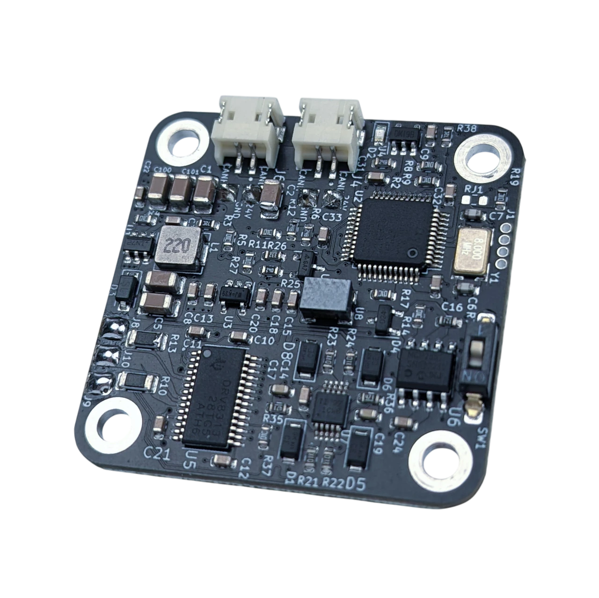
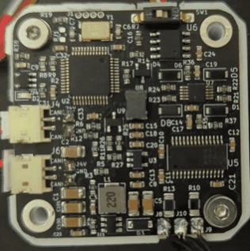

# The driver at a glance

The Spectral Micro is a field-oriented controller for small three-phase brushless motors: gimbal motors and other
low-current motors with a phase resistance of a few ohms. It mounts behind the motor, reads the rotor position
from a magnet on the motor shaft, and drives the three phases with sinusoidal currents placed from that position,
the way a servo drive does. The motor can be commanded in position, speed, current (torque) or impedance, holds a
position at standstill, reports where it is, and runs quietly and efficiently. It is made for robot joints, legs,
arms and grippers.

<figure markdown="span">
  { width="520" }
  <figcaption>Figure 1: The Spectral Micro driver, 39 × 39 mm, with the encoder chip in the middle of the board.</figcaption>
</figure>

## What is on the board

| Part | What it does |
|---|---|
| STM32F103CB microcontroller | runs the control loops at 5 kHz and the CAN and UART interfaces |
| 14-bit magnetic encoder (MT6816) | reads the position of the magnet on the motor shaft: 16384 ticks per revolution |
| Three-phase driver stage with inline current sensing | drives the phases with up to 2.8 A and measures the phase currents |
| 16 Kbit EEPROM | keeps the configuration and the calibration over a power cycle |
| Two CAN connectors and two power connectors | daisy-chain several drivers on one bus and one supply |
| CAN termination switch | the 120 Ω resistor the first and the last node need |
| UART connector (3.3 V) | the serial terminal: every setting, calibration, tuning |
| Thermistor pads | an NTC in the motor windings for temperature protection |
| PIN header | a spare pin for your own use: an analog input or a digital input/output |
| HALL header | pads for hall sensors; not implemented in the firmware |
| JTAG pads (1.27 mm) | the programming adapter, for installing the bootloader or for development |
| Status LED | normal operation, calibration or error, see below |

The connectors and their pinout are in [Connectors and pinout](../03-technical-data/connectors.md).

## What the firmware does

The firmware closes three nested loops on the motor: a current (torque) loop, a velocity loop around it and a
position loop around that, plus an impedance (PD) loop that makes the motor behave like a spring and damper.
A command picks the loop: a current setpoint, a speed, a position or a PD setpoint. An open-loop mode and a
voltage-torque mode exist beside them; [Control modes](../06-operation/modes.md) describes each.

Calibration measures the motor: its phase resistance and inductance, its pole pairs and the order of its phases,
the angle between the encoder and the rotor field, and its torque and velocity constants. Nothing about the motor
has to be typed in; see [Calibration](../05-setup/calibration.md).

The driver protects itself and the motor: it stops on a supply voltage outside the limits, on an encoder fault, on
an over-speed, on a motor over-temperature (with the thermistor), on a hardware fault of the driver stage, on an
E-stop command and on a watchdog that runs out. The status LED and `#Error` tell which; see
[Errors and recovery](../06-operation/errors.md).

## How it is controlled

- **UART**, a 3.3 V serial port at 256000 baud: human-readable commands such as `#P 16384`, and the only way to
  run the calibration. See [Over UART](../06-operation/uart.md).
- **CAN**, 1 Mbit/s, up to 16 drivers on one bus: compact frames for real-time control from a PC with the CANvas
  adapter, a microcontroller or a robot control box. See [Over CAN](../06-operation/can.md).
- **Python**, the `Spectral-BLDC` library on top of CAN. See [With Python](../06-operation/python.md).
- **Motor GUI**, in the browser, over serial or CAN: the usual tool for setup, testing and tuning. See [Motor GUI](../05-setup/motor-gui.md).

## The status LED

| Pattern | Meaning |
|---|---|
| three short flashes and a pause | normal operation: no error, calibrated |
| flashing every 0.5 s | the calibration routine is running |
| on, not flashing | error mode: at least one error is active, or the motor is not calibrated |

The LED can be turned off with `#LED 0`.

| Normal operation | Calibration | Error mode |
|---|---|---|
| { width="180" } | { width="180" } | { width="180" } |

