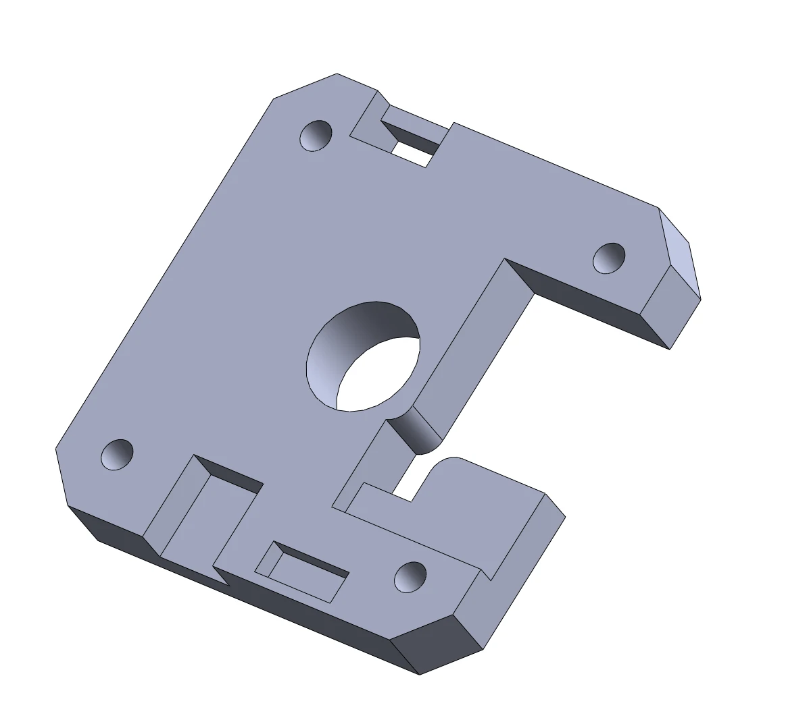

# Mounting on the motor

The board sits behind the motor, with the encoder chip, in the middle of the board, on the axis of the shaft and
1 mm from the magnet. The board's four holes are on the NEMA 17 pattern, 31 mm apart.

## Gimbal motors

A gimbal motor has no standard mounting for a board; a bracket holds the board at the right distance. The
firmware repository has an example to adapt to your motor, `Spectral_micro_bracket.STEP` in
[STEP files](https://github.com/Source-Robotics/Spectral-Micro-BLDC-controller/tree/main/STEP%20files): change
its hole pattern to the motor's bottom holes and its height so that the magnet ends up 1 mm from the chip.

<figure markdown="span">
  { width="500" }
  <figcaption>Figure 7: The example bracket. The motor bolts to one side, the board to the other; the hole in the middle is for the shaft and the magnet.</figcaption>
</figure>

1. Bolt the bracket to the bottom of the motor. The magnet on the shaft's end sits in the bracket's centre hole.
2. Bolt the board to the bracket with M3 screws, with the encoder chip (the bottom of the board, see
   [Connectors and pinout](../03-technical-data/connectors.md)) towards the magnet. Tighten the screws evenly; the
   board must be parallel to the magnet's face.
3. Check the gap: about 1 mm, the magnet not touching the chip. If it is wrong, change the bracket's height or the
   magnet's thickness ([The encoder magnet](magnet.md)).

## Motors with the NEMA 17 pattern

A brushless motor in the NEMA 17 format, such as the 42BLS40 in the [tested motors](../03-technical-data/tested-motors.md),
takes the board directly, with the motor's own rear screws: remove the four screws, put on a spacer that sets the
magnet height, the board on the spacer with the chip towards the magnet, and longer M3 screws in. Check the gap.

!!! warning "The board is bare"
    Nothing on the board may touch the motor's housing or a metal bracket. Keep the bracket clear of the
    components on both sides of the board (the connectors on the bottom need room), and keep metal swarf and
    screws away from the board while you work.
