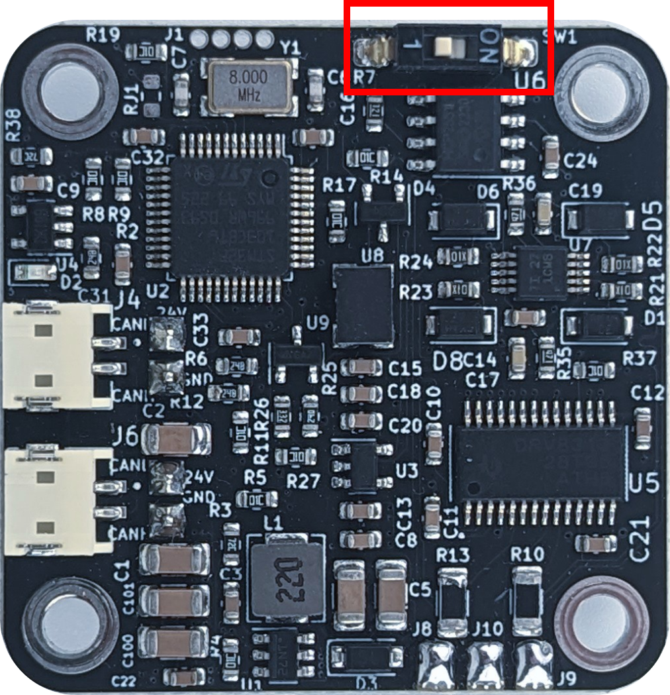

# Power and the CAN daisy chain

Each driver has two power connectors (JST XH) and two CAN connectors (JST ZH). The second connector of each pair
feeds the next driver, so a chain of drivers hangs on one supply cable and one CAN cable.

<figure markdown="span">
  { width="700" }
  <figcaption>Figure 8: Power and CAN pass from driver to driver. The first and the last node on the bus have their termination switch on.</figcaption>
</figure>

## Power

- 12 to 29 V DC, 24 V recommended. **DC+ to the positive supply, DC− to the negative**; reversed polarity destroys
  the driver.
- The power connectors are rated for 4 A. A chain of drivers shares that: with motors at 1.5 A each, plan for at most two or three drivers per chain that draw their full current at the
  same time (three or four with 10 Ω gimbal motors), and feed a longer chain from
  both ends or from several supplies.
- A motor that decelerates pushes energy back into the supply. A lab supply or a battery absorbs it; a supply that
  cannot (some switch-mode supplies) sees its voltage rise, and the driver raises a Vbus error above 29.5 V.

## The cable orientation

!!! danger
    The daisy-chain cables are keyed by their orientation, not by the connector: the same 2-pin cable fits both
    ways, and the wrong way puts DC+ on DC−. Every cable must run as in the picture below, the same way at both
    ends. A wrong cable destroys the driver at the moment it is powered.

<figure markdown="span">
  { width="600" }
  <figcaption>Figure 9: The orientation of the daisy-chain cables for CAN and power.</figcaption>
</figure>

The cables from the shop are made this way: [CAN cable](https://source-robotics.com/products/spectral-micro-can-cable),
[power cable](https://source-robotics.com/products/spectral-micro-power-cable), and all of them under
[connectors and cables](https://source-robotics.com/pages/connectors-and-cables).

## CAN

- CAN 2.0, 1 Mbit/s, 11-bit identifiers. Up to 16 drivers on one bus, each with its own node ID (0 by default;
  set it with `#CANID` or Send_CAN_ID and save).
- Twisted-pair wire; keep the bus short at 1 Mbit/s (a few metres at most).
- **Termination:** the first and the last node on the bus need a 120 Ω resistor between CAN H and CAN L. The
  switch next to the CAN connectors turns the driver's resistor on (**ON**). Drivers in the middle stay off. A bus
  with the right termination measures about 60 Ω between CAN H and CAN L with everything unpowered.
- A PC joins the bus with the [CANvas adapter](https://source-robotics.com/products/canvas-usb-to-can-adapter),
  which has its own termination.

<figure markdown="span">
  { width="520" }
  <figcaption>Figure 10: The termination switch, ON for the first and the last node.</figcaption>
</figure>
