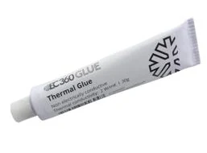
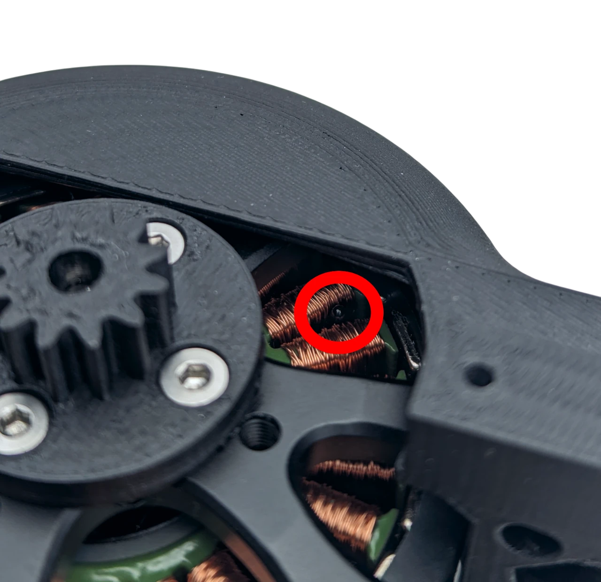

# Thermistor

A 100 kΩ NTC thermistor in the motor lets the driver stop before the motor overheats. It is optional, and off by
default; use it on any motor that runs near its current limit for long, and on a motor that holds a load at
standstill, which heats one winding without any movement to show it.

!!! warning "Without it, nothing protects the motor from overheating"
    The driver limits the current, not the temperature. A motor that runs continuously, holds a load for long, or
    is set up badly (a current limit above its rating, loops that oscillate, a wrong resistance or inductance) can
    overheat and burn its windings without any warning. With the thermistor fitted and enabled, the driver stops
    first. The starter kit includes one.

<figure markdown="span">
  { width="520" }
  <figcaption>Figure 11: The thermistor on the TERM and 3V3 pads.</figcaption>
</figure>

## Fitting it

Solder the thermistor's leads to the two thermistor pads, TERM and 3V3 ([Connectors and pinout](../03-technical-data/connectors.md)).
Put its bead inside the motor's windings, where the heat is: on a gimbal motor the windings are open at the
bottom and can be reached through one of the mounting holes or past the edge of the stator. Thermal cement holds
the bead in place and conducts the heat; keep the leads clear of the rotor.

<figure markdown="span">
  { width="220" }
  <figcaption>Thermal cement: it sets hard and conducts heat. Thermal paste stays soft and lets the bead move, ordinary glue insulates it. <a href="https://s.click.aliexpress.com/e/_c3dBOwTD" target="_blank" rel="noopener">Where to buy it</a>.</figcaption>
</figure>

{ width="520" }

## Enabling it

```
#Term 1
#Tlim 75
#Save
```

`#Temp` then prints the temperature; with the thermistor disabled it prints `Temp Off`. Above the limit the driver
raises a temperature error and stops; it clears with `#Clear` once the motor has cooled. 75 °C is the default
limit and a safe one for the enamel of most small motors; do not go higher unless the motor is rated for it.

Over CAN, Send_Respond_Temperature returns the temperature, and the temperature error is one of the bits of
Send_Respond_State_of_Errors.
