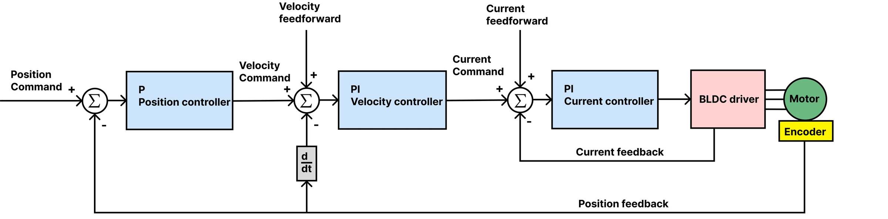
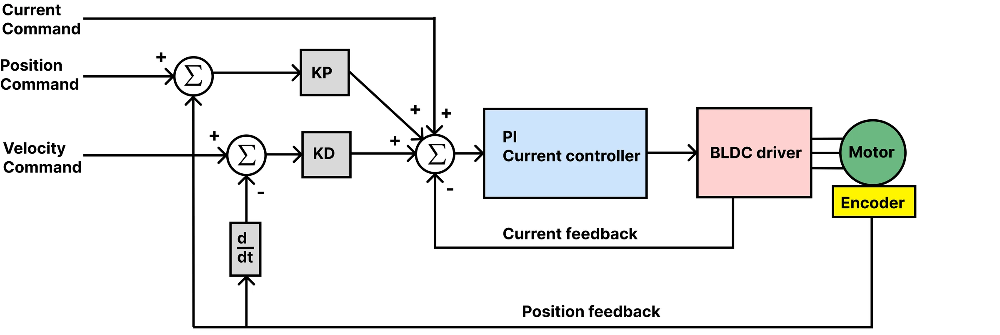

# Current limit and loop tuning

Calibration leaves the driver with current loop gains computed for your motor and with conservative velocity and
position gains. Two things remain: the current limit, which you must set for your motor, and the loop gains, which
you tune if the defaults do not suit it. Motor GUI shows the motor's response on its plots while you change a gain,
which is what makes tuning quick.

## The current limit

Set the current limit to the rated phase current of your motor in mA. Calibration uses its own 1600 mA for its
steps and, from firmware 109, puts your limit back when it ends (107 and older left 1600 mA: set it again after
calibrating there). The factory default (`#Default`) of 1000 mA suits the gimbal motors in
[Tested motors](../03-technical-data/tested-motors.md); a motor rated for more can go up to the driver's 2800 mA.
`#Ilim` clamps the limit to 2800 mA; from firmware 109 Send_Limits over CAN does too. The firmware does not trip
on phase current by itself; the MOSFET driver's hardware protection only catches a hard fault. A limit above the
motor's rating overheats the motor.

=== "Motor GUI"
    In the limits set the current limit, then **Save**.

=== "Terminal"
    ```
    #Ilim 1500
    #Save
    ```

Crunching and whining sounds at speed usually mean the current limit, or the current loop gains, are too high.

## The loops

{ width="800" }

Tune from the inside out: the current loop first, then velocity, then position. Before you start:

- The motor must be calibrated and without active errors; the driver refuses the control modes otherwise.
- Fix the motor to the bench, nothing on the shaft. A loop that oscillates can shake a loose motor off the table.
- If the defaults oscillate, lower all gains until the motor is quiet, then raise them one at a time in small steps.

=== "Motor GUI"
    The gains are in the settings: change one, *Apply gains*, command a move with the jog controls and read the
    response on the plots. *Apply preset* loads a starting set for a kind of motor: a product preset writes its
    own current and velocity gains; the *Generic motor* presets set soft limits and velocity gains and leave the
    current gains to `#Cbw` and the calibration. Apply a preset before you calibrate, so that the calibration
    computes the current gains.
    **Save** when you are done.

=== "Terminal"
    Each gain is a command: `#Kpiq 0.5`, `#Kpv 0.02`, …, then `#Save`. Command a move with `#Iq`, `#V` or `#P`
    and judge the response by ear and by `#Cyc 20`, which streams position, speed and current.

### The current loop

The current loop is a PI controller that turns a current request into a voltage. Its gains `Kpiq` and `Kiiq`
follow from the motor's resistance R, its inductance L (both measured by calibration) and one number, the
bandwidth: Kpiq ≈ ω·L and Kiiq = ω·R·T, with ω = 2π × the bandwidth and T the 200 µs control period (Kiiq is
applied once per control loop). The PI then cancels the coil's own lag, and the
current follows a request like a first-order filter at that bandwidth. Calibration computes them this way at
160 Hz, the default from firmware 109; so does setting the bandwidth:

=== "Terminal"
    ```
    #Cbw 200          new gains at once from R and L; it prints them
    #Save             keeps the gains (the bandwidth itself is 160 again after a power cycle)
    ```

=== "CAN"
    Send_Parameter(49, 200), then Send_Save_config. Reading parameter 49 gives the bandwidth the gains in force
    amount to with the R and L in force.

The bandwidth can be 10 to 500 Hz (a tenth of the 5000 Hz control loop). A higher one follows a request and
rejects a disturbance faster, and is louder. Gains set by hand with `#Kpiq` and `#Kiiq` work too; parameter 49
then tells which bandwidth they amount to.

!!! note "Drives calibrated with older firmware"
    Firmware 107 and older computed the gains for 500 Hz on the 5000 Hz loop, which is fast for that loop rate.
    Their saved gains stay as they are after an update to 109: parameter 49 reads about 500 Hz until the drive is
    calibrated again. Calibrate again after the update where the motor can turn freely. A calibration made with
    107 or older stored the resistance about 10 % and the inductance about 45 % too low, so `#Cbw` on the old
    values gives gains for a lower bandwidth than it names (on an SSG-48 apply its preset instead, which writes
    the gains). 160 Hz is the default; on the gimbal-motor bench 300 Hz settled a speed step 3.6 times faster at the
    same holding noise, and 500 Hz added half again the current noise. The SSG-48 preset sets 300 Hz. See
    [Upgrading from older firmware](../07-firmware/upgrading.md).

Test with a current setpoint of a few hundred mA (*Jog current*, or `#Iq 300`): the motor should push with a
steady, quiet torque. Keep the current well under the limit.

### The velocity loop

1. Raise `Kpv` until the motor oscillates at a steady speed command, then back off 20 %.
2. Raise `Kiv` slowly until it oscillates, then back off a little. `Kiv` is an integrator: too much makes the
   motor unstable, none leaves a steady-state error.
3. Test with a speed setpoint (*Jog velocity*, or `#V 20000`; 16384 ticks per second is one revolution per
   second) and with different speeds.

### The position loop

1. Raise `Kpp` until the motor overshoots or oscillates when it reaches a target, then back off.
2. Test with a position step (*Jog position*, or `#P 16384` and `#P 0`): one revolution and back. The response
   should be quick, without overshoot; the plot shows both.

### Testing

Run the motor over the whole range of speeds and loads it will see, with a load if you can, and adjust. Then save.

## The speed estimate

The velocity loop needs the speed, which the driver estimates from the encoder count. From firmware 109 parameter
50 picks how:

| Parameter 50 | Estimate | How it behaves |
|---|---|---|
| 0 | moving average of the last 20 count differences | about 2 ms late, in steps of 250 ticks/s: the estimate of every release before |
| 1 | PLL, the speed is its integrator | smooth, a little late |
| 2 (default) | direct PLL, integrator plus the proportional term | almost no lag, a little more noise |

Both PLLs are critically damped at the natural frequency of parameter 51, 100 Hz by default (10 to 250 Hz). The
lag of the moving average is what limits the velocity gain. On the gimbal-motor bench the direct PLL at 100 Hz
allowed twice the `Kpv` of the moving average before the motor vibrated (0.11 against 0.056), lowered the speed
ripple 1.3 to 3.4 times between 1500 and 48000 ticks/s, and cut the overshoot of a speed step from about 67 % to
12 % at the same gains. At 60 Hz it overshot more, at 200 Hz it held with more current noise. Calibration and the gripper's stop
detection always use the moving average. Neither parameter is kept by Save. The speed in Respond_data_pack_1 and
Send_Respond_Encoder_data, the watchdog descend and the capture is the picked estimate.

## Commutation delay compensation

The voltage a control loop sets reaches the motor later than the angle it was computed from was read: the rest of
the loop, the wait for the PWM update and half a control period. By then the rotor has turned on, and the voltage
lands a little behind the angle it was meant for. Parameter 64 turns the output voltage forward by the angle the
rotor covers in that delay, in the closed-loop modes above 100 ticks/s; 1 to 500 µs are accepted. The default is
234 µs, the Spectral Micro's own delay measured on the bench: 20 points between 24000 and 120000 ticks/s gave one
delay within 2 to 4 % of theory at every speed. Without it the field lags about 6° electrical at 120000 ticks/s.
The delay belongs to the driver's timing, not to the motor, so it suits any motor; 0 switches it off. It is not
kept by Save.

## The finer points of the velocity loop

Two settings for special cases, both off by default and not kept by Save; both were tested on the STEPFOC bench:

- **Position input filter**, parameter 74 (Hz, 0 to 200). A host that sends positions at a fixed rate sends a
  staircase; without the speed the steps are all the loops see. The filter turns the staircase into a smooth path
  and makes its own speed from it, in position and PD modes. Use it only for a host that sends positions
  **without** the speed feedforward, at about the host's rate ÷ 12 (8 Hz for 100 Hz); with a host that sends the
  speed it makes the tracking worse.
- **Velocity-integral deadband**, parameter 75 (ticks, 0 to 2000). In position mode the velocity integral sees the
  position error less this band, so a holding motor stops pushing against a small error it cannot correct. It
  trades accuracy for holding current.

## Impedance (PD) mode

{ width="800" }

In PD mode the motor behaves like a spring and a damper: the torque is `KP × (setpoint − position) + KD × (speed
setpoint − speed) + feedforward current`. Set `KP` and `KD` (the gains, or `#KP`, `#KD`, or Send_PD_Gains), then
command with `#PD`, `#PDV` and `#PDI` or Send_data_pack_PD. Start with a small `KP` and `KD` of 0, raise `KP` until
the motor holds position firmly, then add `KD` until it stops ringing. The [theory corner](../appendix/theory.md)
explains the loop.

## Limits

- The velocity limit (`#Vlimit`) clamps the speed the loops may command, in encoder ticks per second. A rough
  maximum for your motor is 0.8 × Vbus × KV × 16384 / 60 ticks per second, with KV from calibration.
- The voltage limit (`#Vlim`) clamps the voltage of the current loops in mV; 0 uses the supply voltage.
- `#Rstint 1` resets the integrators on every new setpoint, which avoids windup when a program sends one setpoint
  after another with large steps.
