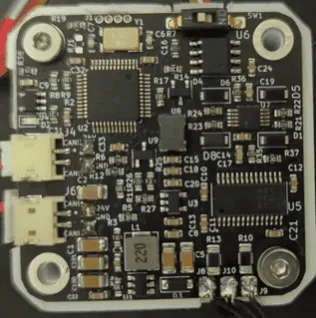
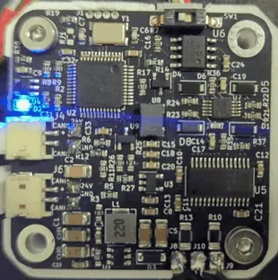
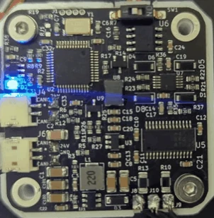

# Errors and recovery

When the driver detects a fault it disables the motor, goes to idle, turns the status LED on steadily and sets
the error bit in every CAN frame it sends. A disabled motor coasts, also when `#Brake 1` is set. The driver stays
there until the error is cleared.

## Seeing the error

- **The LED**: on and not flashing means error mode (or not calibrated). Three short flashes and a pause is
  normal operation; fast flashing, about 10 times a second, is calibration.
- **`#Error`** prints `In error state!` or `No errors!`, followed by one line per active error.
- **Send_Respond_State_of_Errors** returns every flag as a bit; **the error bit** of any frame says whether there
  is one.

| Normal operation | Calibration | Error mode |
|---|---|---|
| { width="180" } | { width="180" } | { width="180" } |

In error mode the LED does not flash: it stays on, as in the photo on the right.

## The errors

| Error | `#Error` line | Cause | What to do |
|---|---|---|---|
| Vbus | `Vbus error` | the supply voltage is below 9 V or above `#Vmax` (29 V after `#Default`). From firmware 109 a low voltage is not checked for the first 500 ms after power-up, while the supply ramps up | check the supply and the cable; a decelerating motor can push the voltage up |
| Encoder | `Encoder error` | the magnet is not detected or the reading is invalid | magnet distance and type, see [The encoder magnet](../04-mounting/magnet.md) |
| Driver | `Drv error`, and `FAULT pin is HIGH` while the fault lasts (the pin is low then: the text names the wrong level) | the MOSFET driver's own protection tripped: undervoltage, thermal shutdown or overcurrent | lower the current limit, cool the driver, check for a short between the motor leads |
| Velocity | `Velocity error` | the measured speed exceeded 20,000,000 ticks/s (about 1220 revolutions per second), a fixed limit that `#Vlimit` does not change | a runaway or an encoder fault: check the magnet and the encoder, see [The encoder magnet](../04-mounting/magnet.md) |
| Temperature | `Temp error` | the thermistor reads more than `#Tlim` (75 °C by default), with `#Term 1` | let the motor cool; lower the current limit |
| E-stop | `Received ESTOP command` | Send_ESTOP was received | clear it when it is safe |
| Watchdog | `Watchdog error` | no motion command or answered request over CAN within the watchdog time (Send_Watchdog); what the motor does then is the watchdog's action, see [The watchdog](watchdog.md) | the host stopped sending; fix the host, then clear. See [The watchdog](#the-watchdog) |
| Wrong product | `Wrong firmware for this board (product lock)` | from firmware 109: this board was calibrated by the other product (a STEPFOC firmware on a Spectral Micro, or the other way round), so the firmware drives nothing ([The product lock](diagnostics.md#the-product-lock)) | flash the right firmware; it does not clear otherwise |
| Not calibrated | `Not calibrated` | the motor has not been calibrated since `#Default`, or the EEPROM is invalid | run `#Cal` and `#Save` |
| Current | `Current error` | reserved; this firmware never raises it | — |

## Clearing

`#Clear` or Send_Clear_Error clears the flags and goes to idle. An error whose cause is still present comes
straight back: a Vbus error at 2 V stays until the supply is right; once the supply is 24 V, one `#Clear` returns
the driver to normal operation. The calibration error clears only by calibrating (or, for a motor you know is
calibrated, `#Calibrated 1`).

## The watchdog

The watchdog is set over CAN only, with Send_Watchdog (or parameters 6 and 7); there is no UART command for its
time. It counts the motion commands (Send_data_pack_1, Send_data_pack_PD, Send_gripper_data_pack) and the requests
the driver answers (the Send_Respond_ remote frames, Send_Get_Parameter, Send_Buffer_Read). Other CAN frames and
UART commands do not reset it. Send_Save_config keeps it over a power cycle, like the heartbeat interval. What the
driver does when it runs out is the watchdog's action ([The watchdog](watchdog.md)).

A driver with a saved watchdog that is used over UART only, or by a host that sends no motion command, raises a
watchdog error each time the watchdog time runs out, also right after `#Clear`. To turn it off, send Send_Watchdog
with 0 and then Send_Save_config over CAN. Without a CAN adapter, `#Default` turns it off too, but it also erases
the calibration ([Saving the configuration](../05-setup/saving.md)); from firmware 109 it keeps the node ID.

## When the driver does not answer

- No LED at all: no power. Check DC+ and DC− and the cable orientation.
- LED on, no answer on UART: the baud rate (256000), TX and RX crossed, the adapter's port.
- No answer on CAN: the node ID, the termination (about 60 Ω across the bus, unpowered), 1 Mbit/s on the adapter.
- `#Info` shows `-1` or nonsense: the EEPROM holds values the firmware does not expect, usually from an older
  release (see [Saving the configuration](../05-setup/saving.md#the-check-at-power-up)); `#Default`, then
  calibrate again.

[Troubleshooting](../08-troubleshooting/index.md) goes through the symptoms one by one.
