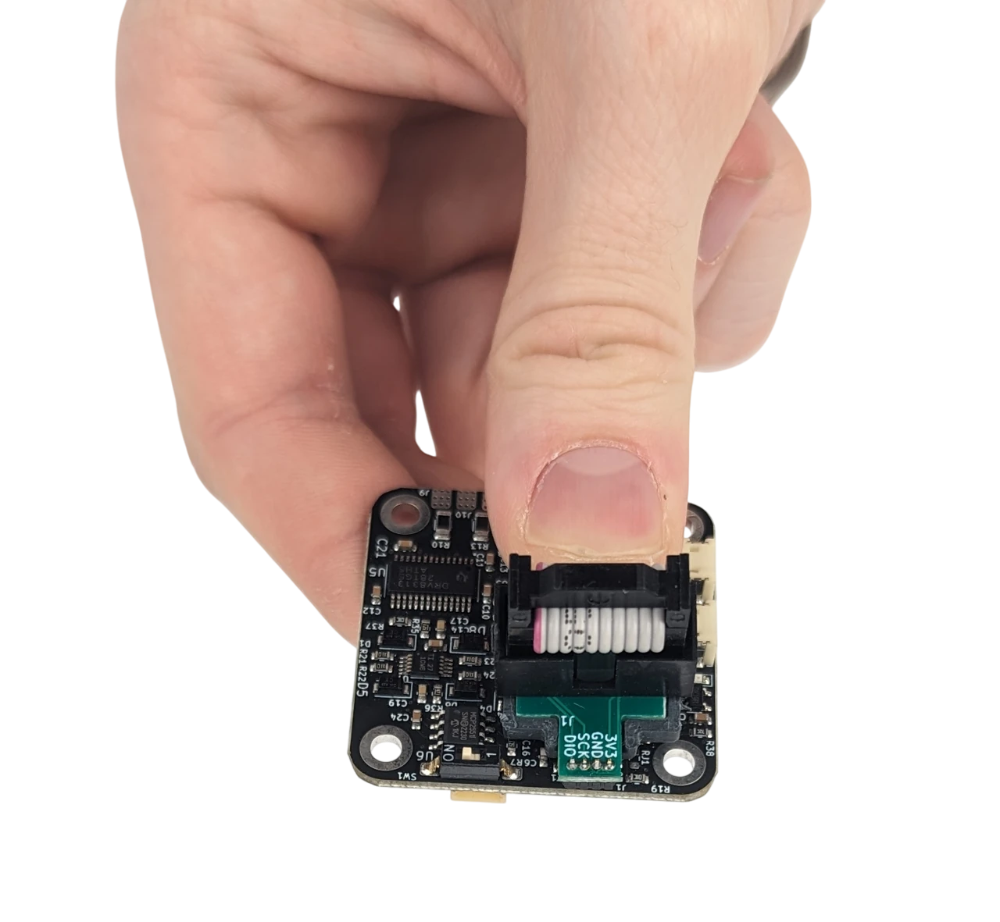
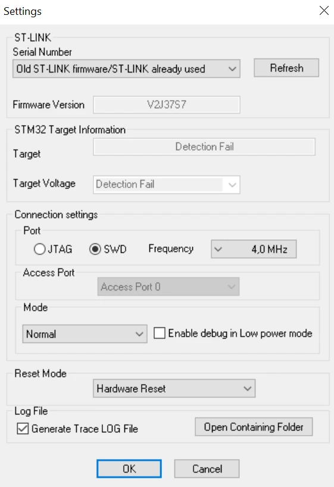
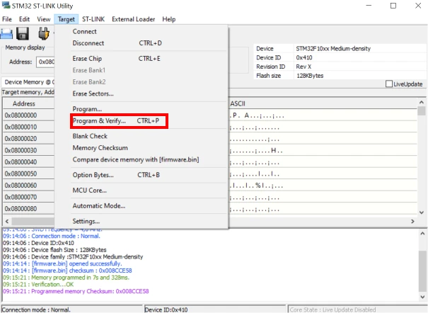

# Installing the bootloader on an older board

A driver running firmware 101 or older has no bootloader: its firmware starts at the beginning of the flash. A
driver that reports 101 may run 104 and have the bootloader all the same; check first, as in
[Drivers that report 101](releases.md#drivers-that-report-101). To
run any release from 104 on (104 is the first release built for the bootloader), which is linked to start above
the bootloader, the bootloader must be installed once, with a programming adapter on the JTAG connector. After
that, every update goes over UART or CAN.

!!! warning
    Disconnect the motor supply and the UART adapter before connecting the programming adapter. The adapter
    powers the board at 3.3 V.

## What you need

- The [programming adapter](https://source-robotics.com/products/jtag-programming-adapter-1-27-pitch) (an ST-LINK
  with the 1.27 mm pogo-pin adapter for the JTAG pads), or any ST-LINK, J-Link or OpenOCD-compatible probe wired
  to 3.3 V, GND, SWDIO and SWCLK.
- [STM32CubeProgrammer](https://www.st.com/en/development-tools/stm32cubeprog.html) or the older
  [STM32 ST-LINK Utility](https://www.st.com/en/development-tools/stsw-link004.html) on the PC, with the
  [ST-LINK drivers](https://www.st.com/en/development-tools/stsw-link009.html).
- The bootloader binary from the [bootloader repository's `bin/` folder](https://github.com/Source-Robotics/stm32f103c-bootloader/tree/main/bin);
  its `README.md` names the current file.

=== "Windows"
    STM32CubeProgrammer or the ST-LINK Utility, and the ST-LINK USB driver (STSW-LINK009) for the adapter.

=== "Linux"
    STM32CubeProgrammer; the ST-LINK Utility runs on Windows only. The adapter needs no driver, but your user
    needs access to its USB device: install the udev rules that come with STM32CubeProgrammer, or run it with
    `sudo`.

=== "macOS"
    STM32CubeProgrammer; the ST-LINK Utility runs on Windows only. The adapter needs no driver.

{ width="520" }

## Steps

1. Connect the adapter to the JTAG pads and the PC.
2. In the programmer, connect to the target (SWD). The STM32F103CB shows up with 128 KB of flash.
3. Erase the chip, or at least the application region: the old firmware and the bootloader must not overlap.
4. Program the bootloader binary at address **`0x08000000`**.
5. Disconnect the adapter, power the driver. The bootloader finds no valid application and waits in bootloader
   mode (the LED stays off).
6. Flash the firmware release through the bootloader, over UART or CAN, as in
   [Updating through the bootloader](update.md).
7. `#Info` shows the new release. `#Default`, then calibrate (`#Cal`), set the current limit (`#Ilim`) and
   `#Save`; see [Calibration](../05-setup/calibration.md).

!!! success "Check"
    `#Info` prints the release you flashed, and a driver powered up while `bl_flash.py list` or Motor GUI's
    *Scan bootloaders* is polling answers in its first two seconds: the bootloader is there. If the firmware does
    not start, see [Updating through the bootloader: when it fails](update.md#when-it-fails).

!!! note "Memory layout"
    `0x08000000`–`0x080022FF` bootloader, `0x08002C00` its configuration page (board ID, the application's CRC),
    `0x08003000`–`0x0801FFFF` the application (116 KB). The bootloader keeps a magic value in RAM to hand over
    to the application in about 10 ms on a normal boot.

## The programmer's settings

In ST-LINK Utility, *Target → Settings* with SWD and the default frequency works; *Target → Program & Verify*
with the start address `0x08000000`. The pictures of the old flashing procedure apply to the connection and the
settings dialog:

| Settings | Programming |
|---|---|
| { width="420" } | { width="420" } |

The same adapter uploads a firmware you build yourself, see [Building from source](building.md).
