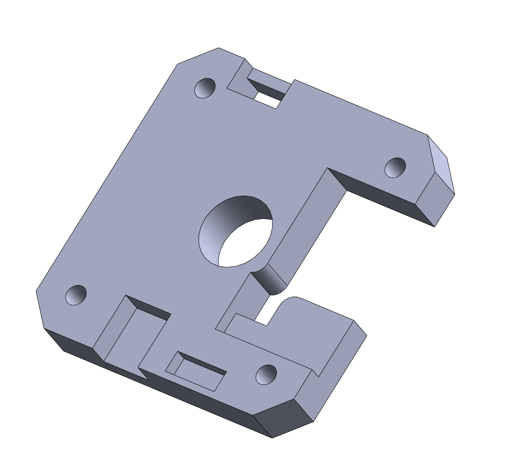
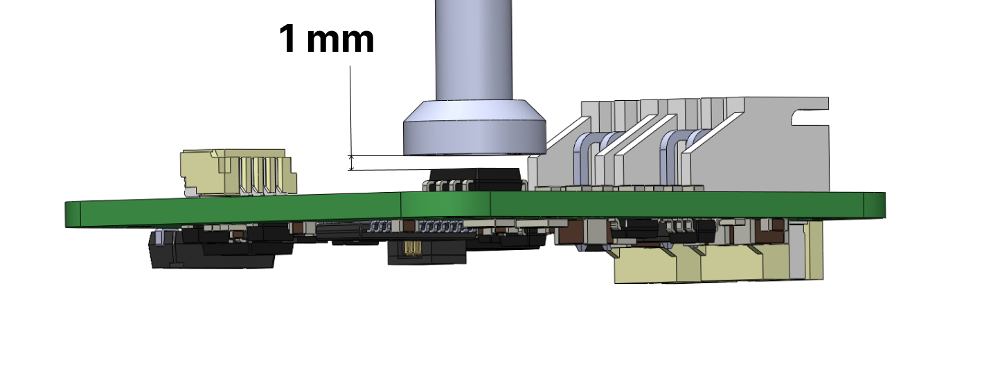
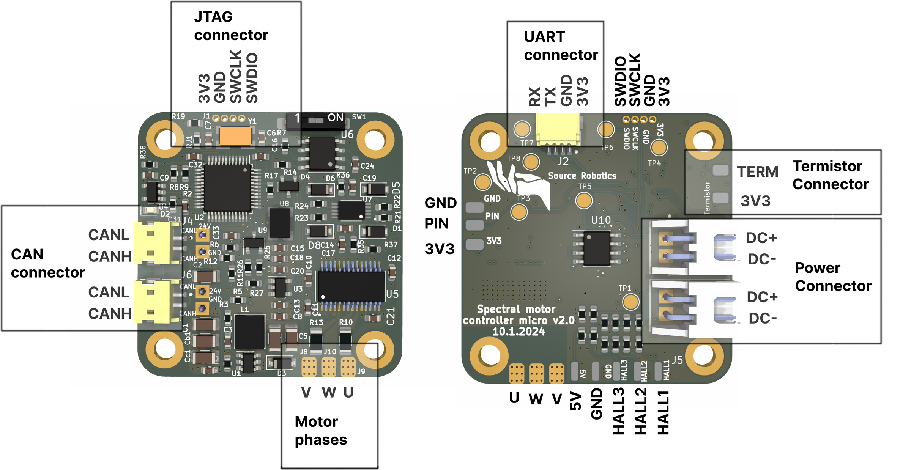
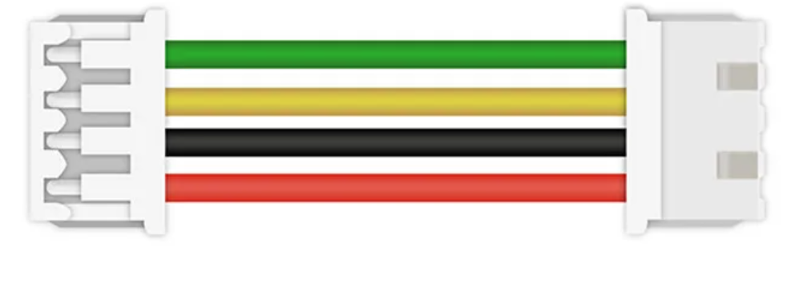
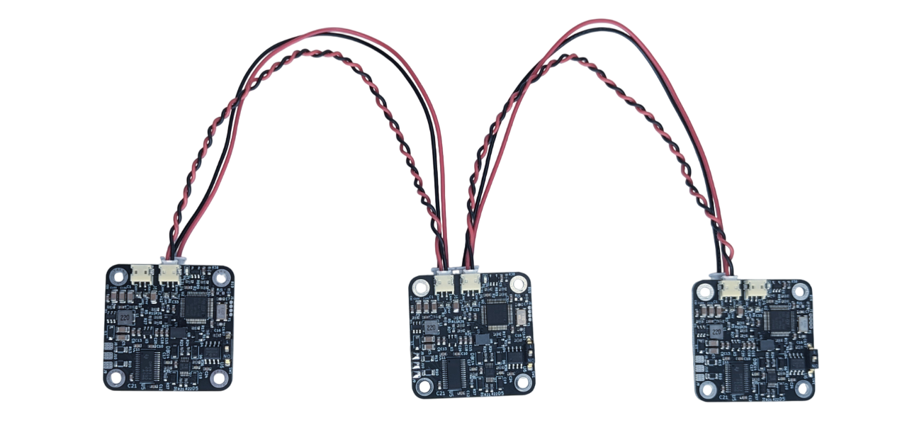
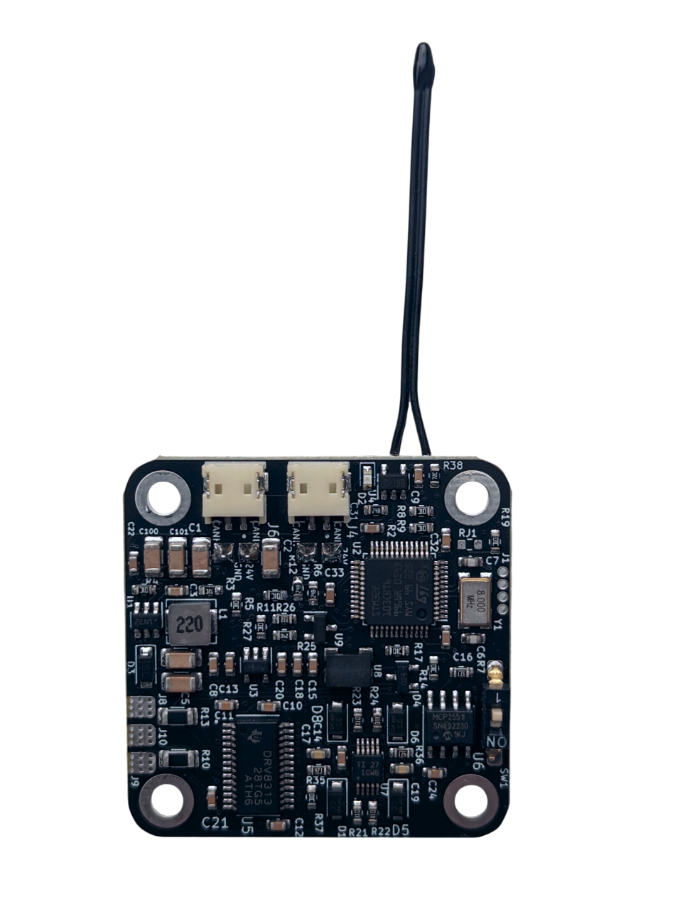
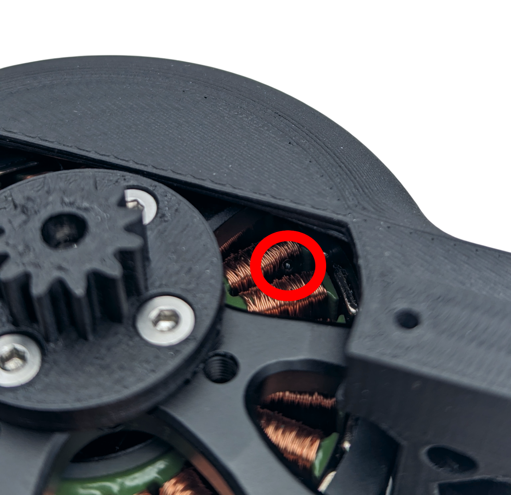
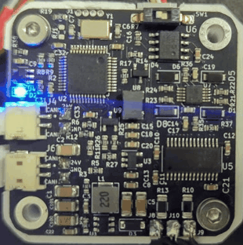
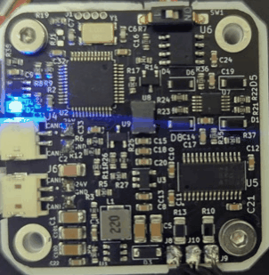

# Getting started

## Where to buy

You can buy a [Spectral Micro starter kit](https://source-robotics.com/products/spectral-micro-bldc-starter-kit) or a [single Spectral Micro driver](https://source-robotics.com/products/spectral-micro-bldc-controller) in the Source Robotics shop.

## Recommended hardware

1. [Diametrically magnetized magnet](https://source-robotics.com/products/6x2-5mm-diametrical-neodymium-magnet)
2. BLDC motor; see the [tested motors](apage9_3_tested_motors.md)
3. [Programming adapter](https://source-robotics.com/products/jtag-programming-adapter-1-27-pitch)
4. [Serial adapter](https://source-robotics.com/products/usb-to-serial-adapter)
5. [CAN adapter](https://source-robotics.com/products/canvas-usb-to-can-adapter) 
6. [Thermistor](https://source-robotics.com/products/100k-ntc-thermistor)
7. [CAN wires](https://source-robotics.com/products/spectral-micro-can-cable) and [power wires](https://source-robotics.com/products/spectral-micro-power-cable)

## Hardware setup

### Mounting PCB to Motor

To mount your BLDC to PCB you can use [example motor bracket](https://github.com/Source-Robotics/Spectral-Micro-BLDC-controller/tree/main/STEP%20files) and modify it for your motor. 

    

Some hardware considerations:

* Distance between motor encoder and magnet should be around 1 mm.
* Hole spacing of Spectral micro is 31 mm

    

## Electrical connections
!!! danger "Reversing the polarity on DC+ and DC- will destroy the board."

    

1. Solder the motor phases to **U, V and W**, in any order. Calibration checks the phase order and tells you to swap two wires when it is wrong, so keep the wires long enough to swap them
2. Connect motor power to one of the **Power connectors** terminals
3. If you are using UART comms. Connect Uart adapter to **UART connector**
4. If you are using thermistor, connect it to **Thermistor connector**
5. If you are using CAN comms. Connect CAN adapter to one of **CAN connectors**
6. When uploading code connect JTAG adapter to **JTAG connector**

!!! danger "Cable orientation"
    **ALL cables used for daisy chain (CAN and power) need to to follow orientation as shown on the image below! Failing to follow that will destroy your motor controller! All correct cables can be bought here: https://source-robotics.com/pages/connectors-and-cables**  

    
 

## Connecting multiple motors (daisy chaining)

Multiple Spectral BLDC drivers and nodes can be connected to single CAN bus using daisy-chaining. First and last nodes on can bus should have termination resistors. On Spectral micro you can flip the CAN switch to "ON" position to enable termination resistor.

!!! tip "Power connectors can handle max 4 A DC. Usually if you are using 10ohm gimbal motor you can daisy chain 3-4 of them."

    
 

## Thermistor connection

Solder the thermistor like shown in the image. 
!!! tip "Thermistor is disabled by default. To enable it use command #Term 1"

    
 

Thermistor needs to be placed inside the motor coils. You can usually do that through one of the mounting holes on the bottom of the motor. You can apply thermal cement on the thermistor in the motor coils to secure it in place and improve thermal conductivity.

    
 

## Status

Normal operation | Calibration | Error mode 
---- | ---- | ----
3 short flashes and a pause 
    
 | Flashing every 0.5 seconds 
    
 | Solid LED, no flashing. 
    

If you have [spectral firmware](https://github.com/Source-Robotics/Spectral-Micro-BLDC-controller/tree/main/Spectral%20BLDC%20Firmware) uploaded on your spectral BLDC LEDs will be in one of 3 states.

* **Normal operation** is when motor controller has no active errors and is calibrated
* **Error mode** is active if any error on the motor driver is active. List of possible errors:
    1. Temperature error
    2. Drv error
    3. Encoder error
    4. Vbus error
    5. Velocity error
    6. Current error
    7. Not calibrated 
    8. Received ESTOP
    9. Watchdog error
* **Calibration** will flash when in calibration routine

## What next?

* The driver arrives with the firmware installed; [Flashing firmware](apage3_flashing_firmware.md) says how to update it with a programming adapter
* You will need to [calibrate your motor](apage4_calibration.md)
* [Tune your PID loops](apage5_PID_tuning.md)
* Follow one of the guides or examples to start using your Spectral Micro driver
