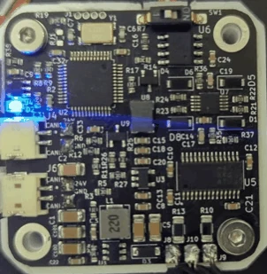
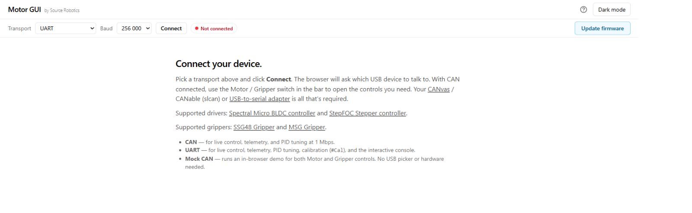

# 2. Connect

The supply powers the motor, the serial adapter connects the PC.

## 1. Connect power and the PC

1. Connect the supply to a power connector: **DC+ to positive, DC− to negative**. Check twice.
2. Connect the serial adapter to the UART connector with the UART cable: TX to RX, RX to TX. 3.3 V only.

    { width="700" }
    { width="700" }

3. Power on.

The LED blinks for about two seconds while the bootloader waits for a host. Then the firmware starts, and the LED
stays on steadily: the driver is not calibrated yet, which it reports as an error state.

{ width="180" }

??? info "The serial adapter alone"
    The serial adapter alone powers the driver's logic: it answers over UART without the supply, but reports a
    Vbus error and will not calibrate or move.

More: [Power and the CAN daisy chain](../04-mounting/power-and-can.md) ·
[Connectors and pinout](../03-technical-data/connectors.md).

## 2. Open Motor GUI or a terminal

=== "Motor GUI"

    1. Open [motorgui.com](https://motorgui.com/) in Chrome or Edge.
    2. Choose the serial connection.
    3. Press **Connect**, and choose the adapter's port.

    { width="800" }

    The driver's identity and state appear: hardware and firmware version, serial number, *Not calibrated*, *No
    errors*.

    If nothing connects: the port, the cable's TX/RX, the browser (Web Serial needs a Chromium browser).

    More: [Motor GUI](../05-setup/motor-gui.md).

=== "Terminal"

    1. Open a terminal on the adapter's port: 256000 baud, line ending CR+LF.
    2. Type `#Info`.

    The driver prints its hardware and firmware version, its CAN ID, whether it is calibrated, and the motor's
    parameters.

    More: [The serial terminal](../05-setup/terminal.md).

!!! success "Check"
    The driver's identity and live state appear before you change settings. A missing connection is covered in
    [Motor GUI](../05-setup/motor-gui.md#opening-the-port) or [Troubleshooting](../08-troubleshooting/index.md).
