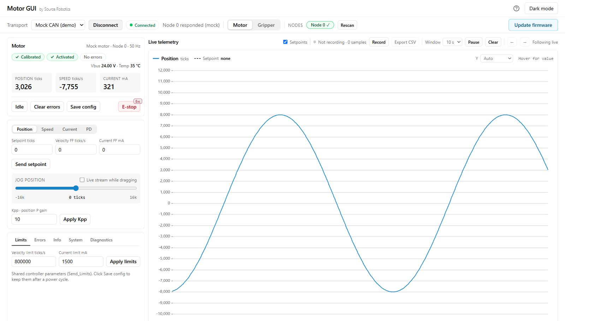

# 4. First moves

The motor is calibrated and saved. Now it moves on command.

## 1. Move it

=== "Motor GUI"

    Use the jog controls:

    - *Jog velocity* turns the motor at a speed;
    - *Jog position* moves it to a position;
    - *Jog current* applies a torque;
    - *Send setpoint* sends a value in the current control mode.

    The plots show position, speed and current while it moves.

    { width="800" }

=== "Terminal"

    ```
    #V 16384        one revolution per second
    #V 0
    #P 0            back to where it started
    #P 16384        one revolution forward
    #Idle
    ```

Position is in encoder ticks, 16384 per revolution; speed in ticks per second; current in mA. If the motor hums
or whines, lower the current limit or tune the loops.

!!! success "Check"
    The position and speed feedback follow the request, and **Idle** stops driving the motor. A motor that
    does not follow needs [Troubleshooting](../08-troubleshooting/index.md) before a load is attached.

More: [Control modes](../06-operation/modes.md) · [Current limit and loop tuning](../05-setup/tuning.md).

## 2. Where to go next

| You want to | Read |
|---|---|
| get to know Motor GUI: the screen, the plots, recordings, several motors | [Motor GUI](../05-setup/motor-gui.md), [Working in Motor GUI](../06-operation/motor-gui.md) |
| control the driver from a program over CAN | [Over CAN](../06-operation/can.md), then [With Python](../06-operation/python.md) |
| put several drivers on one bus | give each a node ID and terminate the ends: [Power and the CAN daisy chain](../04-mounting/power-and-can.md) |
| protect the motor from overheating | [Thermistor](../04-mounting/thermistor.md) |
| update the firmware | [Firmware](../07-firmware/index.md) |
| look up a message or a command | [API reference](../reference/index.md) |
| build something: a wheeled robot, a leg, a compliant arm | [Guides](../guides/index.md) |
| understand why it does not work | [Errors and recovery](../06-operation/errors.md), [Troubleshooting](../08-troubleshooting/index.md) |
