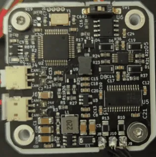
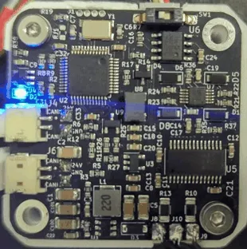
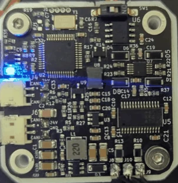

# Errors and LED states

## The LED

| Pattern | State |
|---|---|
| three short flashes, a pause | normal operation: calibrated, no error |
| flashing every 0.5 s | calibration running |
| on, steady | error mode, or not calibrated |
| off | no power, or `#LED 0` |

| Normal operation | Calibration | Error mode |
|---|---|---|
| { width="180" } | { width="180" } | { width="180" } |

## The error flags

The flags as the firmware keeps them, the line `#Error` prints for each, and where each sits in the two bytes of
Send_Respond_State_of_Errors (bits numbered from the most significant).

| Flag | `#Error` prints | Byte, bit | Raised when |
|---|---|---|---|
| `Error` | `In error state!` | 0, 7 | any of the flags below is set (also the error bit of every CAN identifier) |
| `temperature_error` | `Temp error` | 0, 6 | the thermistor reads above `#Tlim` (with `#Term 1`) |
| `encoder_error` | `Encoder error` | 0, 5 | the magnet is not detected or the reading fails its check |
| `Vbus_error` | `Vbus error` | 0, 4 | the supply is below 9 V or above `#Vmax` (29.5 V by default) |
| `Driver_error` | `Driver error (undervoltage, thermal shutdown, or overcurrent)` | 0, 3 | the MOSFET driver's fault output is active |
| `Velocity_error` | `Velocity error` | 0, 2 | the speed exceeds the limit |
| `Current_error` | `Current error` | 0, 1 | never in this firmware; reserved |
| `ESTOP_error` | `Received ESTOP command` | 0, 0 | Send_ESTOP was received |
| `Calibrated` (0) | `Not calibrated` | 1, 7 (1 = calibrated) | the motor has not been calibrated |
| `Activated` | — | 1, 6 | the activated flag, not an error |
| `Watchdog_error` | `Watchdog error` | 1, 5 | the watchdog time passed without a valid CAN frame |

Gripper mode has its own flags in Respond_Gripper_data_pack: a temperature error, a timeout error (the jaw did
not reach its target in time) and an E-stop error; see the [Gripper](can/gripper.md) reference.

## Clearing

`#Clear` and Send_Clear_Error clear every flag except `Calibrated` and go to idle; a flag whose cause persists is
set again at once. The watchdog, E-stop and velocity errors clear and stay clear; the Vbus, encoder, driver and
temperature errors come back until the cause is gone. Calibration clears the calibration error.
